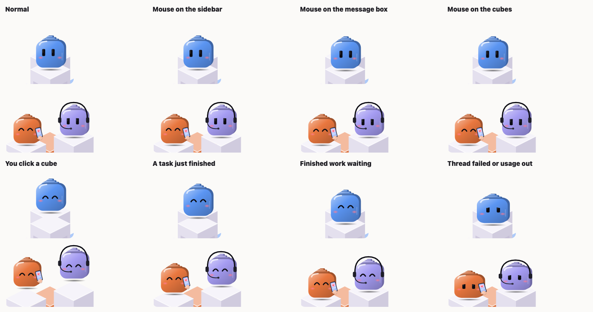

# t3-mods

Looks and moods for T3 Code, built as T3 themes (plain CSS, no extensions).

## Cube City

A small Agnostify cube city in the bottom corners of the chat. The buildings pop in, then three cubes land on the rooftops. While a task runs, the windows light up, a tower builds itself and little data cubes float off the roofs.



The cubes have moods:

- **Glance.** They look toward whatever your mouse is over: the sidebar, the top bar, the message box, or them.
- **Cheer.** When a task in the open thread finishes, they hop with happy eyes.
- **Happy.** While a finished thread you haven't opened yet sits in the sidebar, their eyes stay happy.
- **Sad.** When the open thread fails, or T3 shows its fallback model notice, they slump with droopy eyes.
- **Jump.** Click a cube and they all jump. (Only when the chat area is at least 1540px wide, so they never sit on top of your messages.)

It hides itself on narrow windows and stops moving if your Mac is set to reduce motion.

### Install

```bash
git clone https://github.com/agnostify/t3-mods.git
cd t3-mods/cube-city
t3 theme set out/cube-city.json
```

That publishes and switches to the theme. To go back: `t3 theme set t3-chat`.

### Calm on battery (macOS, optional)

The cubes' idle bobbing and hopping costs a few times more CPU than the rest of the theme. This adds a tiny background helper that keeps them lively on the charger and calm on battery (no idle hops; blinking, glances and moods still work):

```bash
cd t3-mods/cube-city
sh power/install.sh
```

It checks the power source once a minute and swaps the Cube City theme file between the two builds in `out/`. T3 reloads the theme by itself. It never changes which theme you picked, and it leaves a `cube-city` theme file it didn't make alone (`FORCE=1 sh power/install.sh` replaces it). Remove it with `sh power/uninstall.sh`.

### How it works

T3 themes are CSS only, capped at 50,000 characters, with images allowed only as `data:` URLs. Each cube is drawn as three SVG layers (body, everyday eyes, happy eyes) that never get swapped, because swapping an SVG background restarts its animations. Everything that moves is driven from the page by a few registered CSS custom properties (`@property`), and the moods are CSS selectors on what T3 already shows: the sidebar row's status text, the "working" row in the chat, and which area is hovered.

Those hooks aren't a promised API, so a T3 update can quietly switch a mood off. What can break, and how to check, is in [cube-city/breakage.md](cube-city/breakage.md).

### Building it yourself

The built themes are in `cube-city/out/`. Rebuilding needs Agnostify's cube drawing kit (`cube-kit.js` and `cast.js`), which isn't in this repo:

```bash
cd cube-city
CUBE_KIT=/path/to/kit node build.mjs   # writes out/cube-city.json and out/cube-city-calm.json
node harness.mjs                       # writes out/harness.html, a stand-in T3 page for checking every mood
```

`tools/` has the screenshot and CPU scripts used to check it (they need `playwright-core` and Google Chrome).

## License

The code is MIT licensed, see [LICENSE](LICENSE). The Agnostify name and the cube characters (Cubsy, Maya and Nora, and their look) are Agnostify's and aren't covered by that license.
